<picture>
  <source media="(prefers-color-scheme: dark)" srcset="./dark.svg">
  <source media="(prefers-color-scheme: light)" srcset="./light.svg">
  
</picture>

---

## 👋 Introduction

I'm a **backend-first full-stack developer** who treats the frontend as a way to make the backend *visible*. I write APIs before interfaces, and I care about the gap between "it works on localhost" and "it holds up under load."

> Build it → break it → understand why → fix it. Whether that's a REST API or a batting lineup. 🏏

---

## 🧠 About & Focus

Java DSA isn't just interview prep for me. The way I structure loops and reason about complexity shapes how I architect Node.js services. I've spent more time than I'd like to admit debugging JWT refresh-token logic and Redux state mismatches, but that's where the real learning happens.

| | |
|:--|:--|
| 🔭 **Working on** | Full-stack MERN projects with production-ready backends, not tutorial-grade ones |
| 🌱 **Learning** | System Design fundamentals · Advanced DSA & Algorithms · MongoDB internals |
| 🤔 **Exploring** | Where algorithmic thinking meets scalable backend architecture |
| 🤝 **Open to collaborate on** | Open-source projects in AI tooling, automation, or anything that solves a real problem |

---

## 🎓 Education & Community

| | |
|:--|:--|
| **B.Tech, Information Technology** | Bengal College of Engineering and Technology (BCET), Durgapur · 2023 – 2027 |
| **Event Coordinator & Organizer** | [Robonixx Club](https://bcetdgp.ac.in), Technical Department, and IETE Student |

<!--
## 💼 Experience
Add roles here only when you have them: Company · Title · Dates · one line on what you built.

## 🚀 Featured Projects
| Project | Short description | Stack |
|:--|:--|:--|
| [project-name](https://github.com/abhi7044/project-name) | One short factual phrase | Node · Express · MongoDB |

## ✍️ Writing
Add articles or posts here if you publish any.
-->

---

## 🛠️ Engineering Stack

<table>
<tr>
<td width="130"><b>Backend</b></td>
<td>

</td>
</tr>
<tr>
<td><b>Frontend</b></td>
<td>

</td>
</tr>
<tr>
<td><b>Databases</b></td>
<td>

</td>
</tr>
<tr>
<td><b>Languages</b></td>
<td>

</td>
</tr>
<tr>
<td><b>Tools & Cloud</b></td>
<td>

</td>
</tr>
</table>

---

## 📊 GitHub Activity

<picture>
  <source media="(prefers-color-scheme: dark)" srcset="https://github-readme-stats.vercel.app/api?username=abhi7044&show_icons=true&theme=tokyonight&hide_border=true&count_private=true&bg_color=00000000">
  
</picture>
<picture>
  <source media="(prefers-color-scheme: dark)" srcset="https://github-readme-stats.vercel.app/api/top-langs/?username=abhi7044&layout=compact&theme=tokyonight&hide_border=true&langs_count=8&bg_color=00000000">
  
</picture>

<picture>
  <source media="(prefers-color-scheme: dark)" srcset="https://streak-stats.demolab.com/?user=abhi7044&theme=tokyonight&hide_border=true&background=00000000">
  
</picture>

---

## 🤝 Connect

*"Good code, like a good innings, isn't about avoiding failure — it's about knowing exactly why you got out, and coming back better."* 🏏

